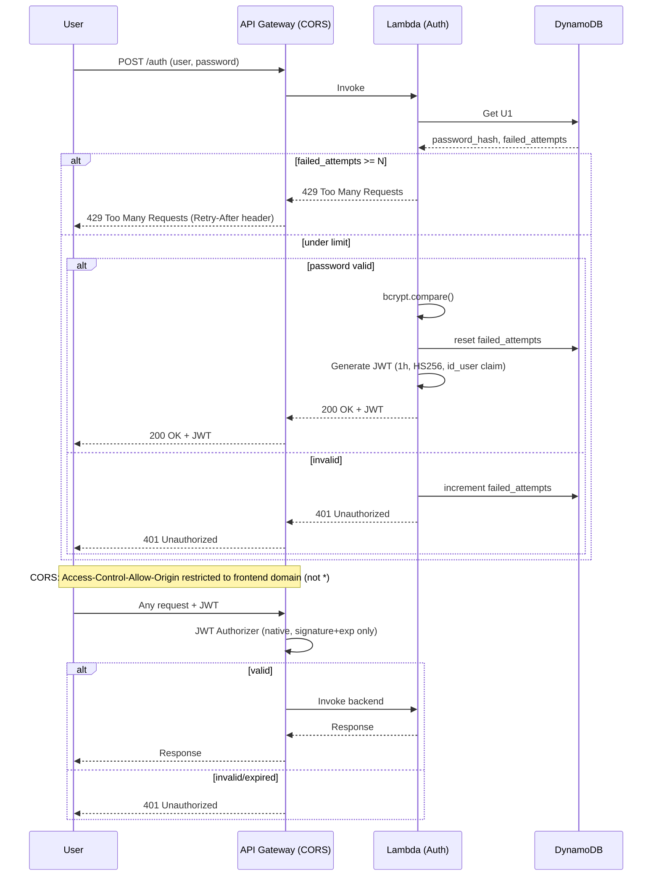
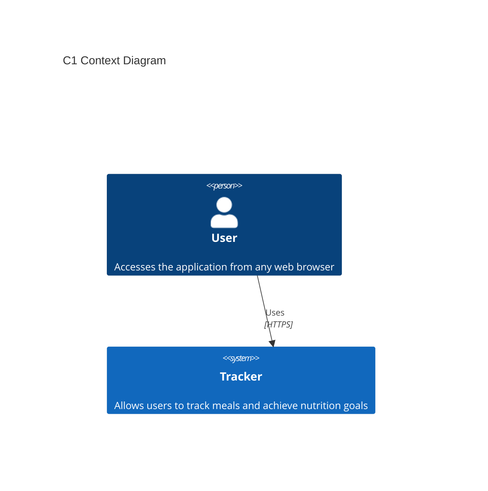
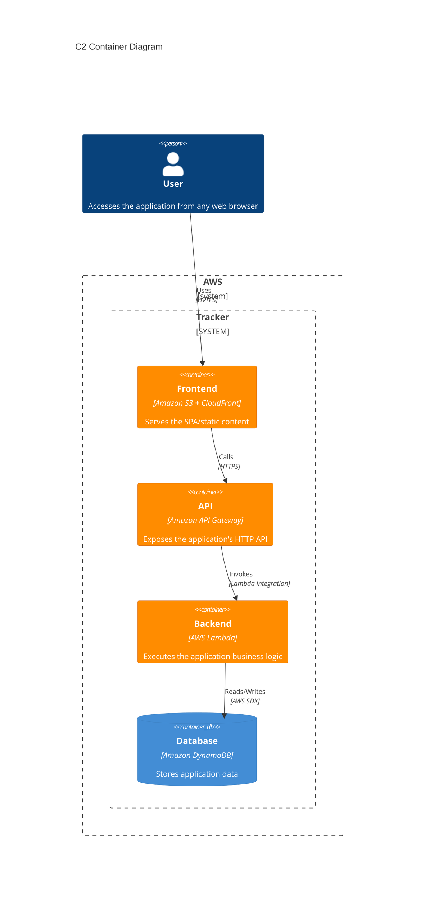
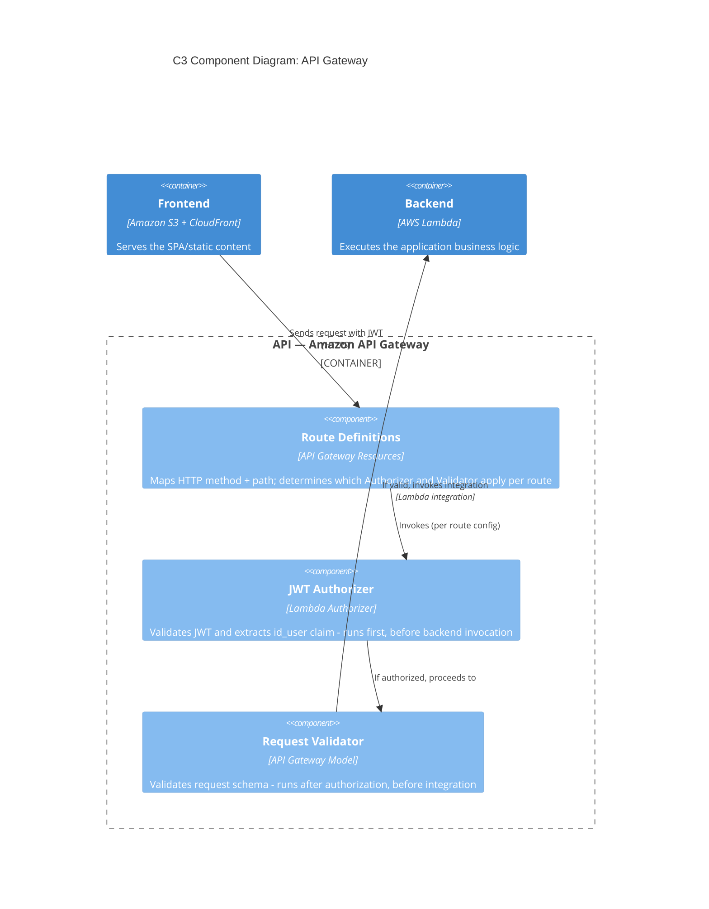
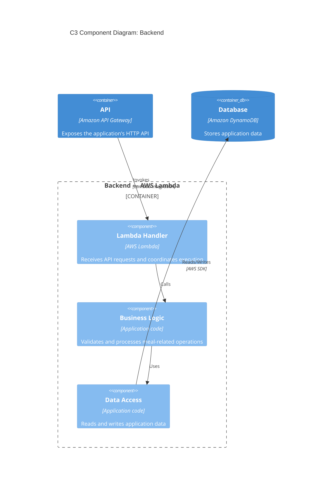
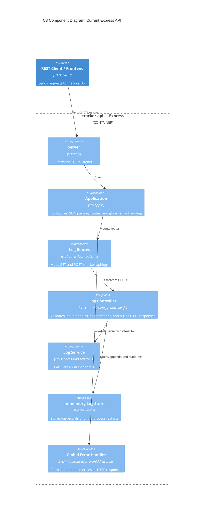
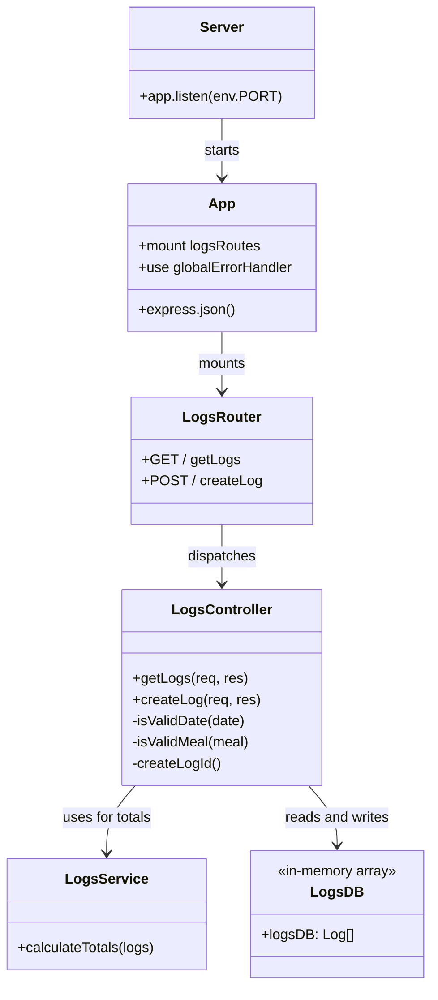
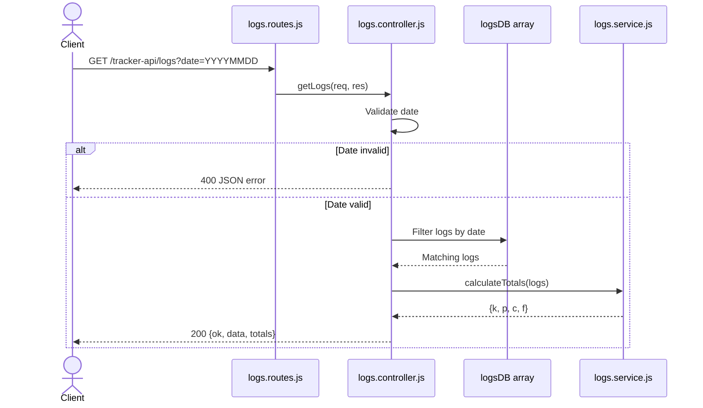
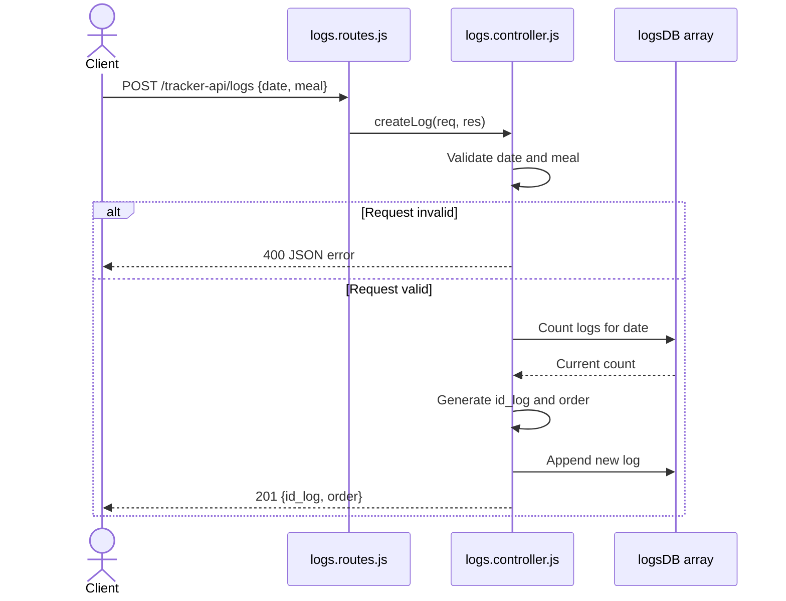

# 🎯 Tracker
A simple app for tracking meals to achieve yours goals in 1-click.

## 📋 Executive Summary
Tracker is built on a simple premise: less is more. Keep deliberately minimal design and remove friction make user's data private by defaul and logging a meal in 1-click.

## 📌 Status
Actively built as an incremental project, applying SDLC practices, cloud architecture principles and AWS Well-Architected patterns.

## 📑 Table of Contents
- [Tracker](#-tracker)
- [I. Requirements](#-i-requirements)
- [II. SecDevOps: Principles & Patterns](#-ii-secdevops-principles--patterns)
- [III. Software & DB Design](#-iii-software--db-design)
- [IV. Architectural Design (C4 Model)](#-iv-architectural-design-c4-model)
- [V. Tech Stack](#-v-tech-stack)
- [VI. Deployment & DevOps](#-vi-deployment--devops)
- [VII. Roadmap](#-vii-roadmap)
- [VIII. License](#-viii-license)

## 📋 I. Requirements
### ⚙️ Functional Requirements
- **FR-01:** Show week navigator.
- **FR-02:** Display user **Goals**. (API Implemented OK)
- **FR-03:** Display **Catalog** List.
- **FR-04:** **Log** with a click.
- **FR-05:** Display **Log** List.
- **FR-06:** Soft delete a **Log**.

### 🏛️ Non-Functional Requirements (architectural characteristics)
| NFR | Measurable Goal |
|---|---|
| NFR-01 Security | 0 credentials in code; JWT lifespan ≤ 1h; automatic secret rotation every 30 days using AWS Secrets Manager; 100% clases Principle of least privilege |
| NFR-02 Maintainability | Test coverage > 80% in business logic layer; cyclomatic complexity < 10 per function |
| NFR-03 Availability | 99.5% monthly (allowing for Lambda cold starts) |
| NFR-04 Scalability | Support 100 concurrent users with < 500ms p95 latency without infrastructure changes |
| NFR-05 Cost | Do not exceed maximum budget of $100/y |

### Architecture Decision Record
#### ADR-01: Authentication method & Password storage
Decision: user access with credentials and password is stored in bcrypt hash.
Why: hashing with salts to resists brute force via cost factor
Trade-off: needs a password-reset flow (not yet in scope).

#### ADR-02: JWT lifetime & signing
Decision: 1h JWT, HS256, secret in Secrets Manager.
Why: native API Gateway JWT Authorizer so short window limits damage from token theft and symmetric signing is enough for a single-service API.
Trade-off: no revocation before expiry mitigated by the short TTL.

#### ADR-03: JWT client storage
Decision: JWT store local in secure cookie never localStorage.
Why: avoids XSS-based token theft risk.
Trade-off: Symmetric HS256 is enough intead asymmetric RS256/ES256

#### ADR-04: Resource ID format
Decision: 6-char case-insensitive alphanumeric ID.
Why: readable and +2 billions combinations means <0.03% collision risk at 1000 items.
Trade-off: not ID unpredictability.

## 🛠️ II. SecDevOps: Principles & Patterns
### 🔐 Security
Security considerations are treated as part of the design and architecture rather than as a separate concern. The project aims to follow principles such as:
* HTTPS for client-to-API communication.
* Separation between application layers.
* Controlled access to persistent data.
* No hard-coded credentials.
### 🎯 Threat Model
| Threat | Mitigation |
| --- | --- |
| JWT theft/replay | 1h exp (TD03), HTTPS-only transport |
| Database breach exposing password | Hashed bcrypt never plaintext (ADR-01) |
| Password brute-force | Temporary block after N failed attempts) |
| Cross-user data access | id_user derived only from JWT claim, never client input |
| Stolen/leaked JWT secret | Stored in Secrets Manager, not in code/env vars committed to repo |
| XSS (Cross-Site Scripting) | JWT sent as Bearer in Authorization header, kept in memory |
| XSS (Cross-Site Scripting) | JWT as Bearer in Authorization header, kept in memory. Strict CSP + output escaping |

### 🔐 Authentication Flow
1. User access with credentials, repeated invalid attempts trigger temporary block (ADR-01).
2. Backend validates credentials, creates session and issues JWT (ADR-02).
3. Client sends JWT hosted on every subsequent API call (ADR-03) .
4. Lambda extracts id_user embedded as claim from JWT (this is the trusted source of truth).

```js
const jwt = require('jsonwebtoken');// explicit verify of alg HS256

function verifyToken(token) {
  return jwt.verify(token, SECRET, {    // implement from AWS Secrets
    algorithms: ['HS256'],    // fix, never get from token (alg none exploit)
    issuer: 'tracker-api',    // Token Replay Attacks
    audience: 'tracker-frontend',    // Token Replay Attacks
  });
}
```
```json
res.cookie('token', jwtToken, {
  httpOnly: true, // Bloquea XSS: JavaScript no puede leer la cookie
  secure: true,   // Solo se envía por HTTPS
  sameSite: 'lax' // Mitiga CSRF
});
```
```json
{ //claims estándar. Agrega iss, aud, jti
  "sub": "U1",
  "iss": "tracker-api",
  "aud": "tracker-frontend",
  "iat": 1732000000,
  "exp": 1732086400,
  "jti": "a1b2c3d4"
}
```
### 🔄 Sequence Diagram: Authentication Flow

### 🔐 Principles
* **YAGNI:** (You Aren't Gonna Need It), **DRY:** (Don't Repeat Yourself), **KISS:** Keep It Simple, Sir.
* **SOLID Principles:** Core design principles to write clean code and maintainable software:
  * **[S]ingle Responsibility:** A module should do **only one thing**.
  * **[O]pen/Closed:** Code should be **open for extension, closed for modification**.
  * **[L]iskov Substitution:** Subclasses must be **fully interchangeable** with their parent classes.
  * **[I]nterface Segregation:** Create **small, specific interfaces** over one general-purpose one.
  * **[D]ependency Inversion:** Depend on **abstractions (interfaces)**, never on concrete implementations.
### 🔐 Patterns
* **Creational patterns:** Provide various creation mechanism increase quality of code.
* **Structural patterns:** Explain how to assemble objects and classes.
* **Behavioral patterns:** Concerned with algorithms and the responsability assignment.

## 📐 III. Front & Back Design

### 🖥️ Frontend Design
    Observer Design Pattern: to show changes in HEADER if logged list is modify.

#### Front Wireframe
```
┌───────────────────────────────┐
│   S | M | T | W | T | S | S   │   (FR-01)
│   1 | 2 | 3 | 4 | 5 | 6 | 7   │   (FR-01)
│    K1/K2|P1/P2|C1/C2|F1/F2    │   (FR-02)
├───────────────────────────────┤
│                               │
│ <  Log[i] (K|P|C|F)      x  > │   (FR-05,FR-06)
│                               │
│ <  Catalog[i] (K|P|C|F) -0+ > |  (FR-03,FR-04)
│                               │
└───────────────────────────────┘
```
### 🗃️ API Gateway

API Version: /v1

Contract:
| Method | Endpoint | Description | Related FR |
| --- | --- | --- | --- |
| GET | `/goals` | Returns user's goals | FR-02 |
| GET | `/catalogs` | Returns Catalogs | FR-03 |
| POST | `/logs?date=` | Log in selected date | FR-04 |
| GET | `/logs?date=` | Returns Logs for a date | FR-05 |
| PATCH | `/logs` | Soft delete Log | TD-06 |

Request/Response examples:
app/tracker-api/src/requests/test.rest

Error handling:
| Status | Case | Example endpoint |
| --- | --- | --- |
| 404 | Resource not found (id_log/id_meal doesn't exist) | `PATCH /log/{id_log}` |
| 409 | Conflict — meal already logged for that date/id | `POST /log` |

### 🗄️ Backend Design
    S-SOLID Design Principles: Single responsibility for components and methods.
    Singleton Design Pattern: Ensure single DB connections.

#### Lambda Function Signatures
```
...
```

### DynamoDB Single-Table Model

**DYNAMO GOAL ENTITY:**
```
{
  "PK": {
    "S": "USER#U1"
  },
  "SK": {
    "S": "GOAL#2026-10-04"
  },
  "Details": {
    "M": {
      "c": {
        "N": "300"
      },
      "f": {
        "N": "90"
      },
      "k": {
        "N": "2500"
      },
      "p": {
        "N": "100"
      }
    }
  }
}
```

**DYNAMO CATALOG ENTITY:**
```
{
  "PK": {
    "S": "USER#U1"
  },
  "SK": {
    "S": "CATALOG#a1a1a1"
  },
  "Type": {
    "S": "MEAL"
  },
  "Order": {
    "N": "1"
  },
  "Details": {
    "M": {
      "c": {
        "N": "22"
      },
      "f": {
        "N": "50"
      },
      "k": {
        "N": "579"
      },
      "label": {
        "S": "almonds"
      },
      "p": {
        "N": "21"
      }
    }
  }
}
```

**DYNAMO LOG ENTITY:**
```
{
  "PK": {
    "S": "USER#U1"
  },
  "SK": {
    "S": "LOG#2026-10-04#c3c3c3"
  },
  "Type": {
    "S": "MEAL"
  },
  "Order": {
    "N": "1"
  },
  "Details": {
    "M": {
      "c": {
        "N": "5"
      },
      "f": {
        "N": "9"
      },
      "k": {
        "N": "90"
      },
      "label": {
        "S": "almonds"
      },
      "p": {
        "N": "4"
      }
    }
  }
}
```

### DynamoDB Queries
| Access Patterns | Search |
Get Credentials (Login): GetItem (PK="USER#U1", SK="CREDENTIALS")
Get Active Goal: Query (PK="USER#U1", SK begins_with("GOAL#"), ScanIndexForward=false, Limit=1)
Get Catalog: Query (PK="USER#U1", SK begins_with("CATALOG#"))
Get Daily Log: Query (PK="USER#U1", SK begins_with("LOG#"+{date}))
Put Catalog: PutItem
Put Log: PutItem

### TrackerTable.yaml (SAM) - IaC
```
Resources:
  TrackerTable:
    Type: AWS::DynamoDB::Table
    Properties:
      BillingMode: PAY_PER_REQUEST
      AttributeDefinitions:
        - AttributeName: PK
          AttributeType: S
        - AttributeName: SK
          AttributeType: S
      KeySchema:
        - AttributeName: PK
          KeyType: HASH
        - AttributeName: SK
          KeyType: RANGE
```

## 🏗️ IV. Architectural Design (C4 Model)
The architecture focuses on simplicity, scalability, maintainability and clear separation of responsibilities prioritizes AWS managed services to reduce operational overhead.

The architecture is documented using the C4 Model, progressively describing the system from high-level to internal components:
### 🌐 C1 Context Diagram
The Context Diagram shows Tracker as a system and its relationship with the user.


### 📦 C2 Container Diagram
The Container diagram shows the main building blocks of the Tracker system and how they communicate.

### 🧩 C3 Component Diagram: API Gateway
Shows internal structure of the API Gateway container.


### 🧩 C3 Component Diagram: Backend
Shows the planned internal structure of the Backend (Lambda) container.


### 🧩 C3 Component Diagram: Current Express API
Shows the components implemented in the local Express API prototype. Authentication and persistent storage are not included yet.


### 💻 C4 Code Diagram: Current Express Modules
Maps the implemented modules and exported functions. The controller currently owns validation and in-memory storage operations; this is the responsibility boundary proposed for refactoring.


### 💻 C4 Code Diagram: GET Logs Request


### 💻 C4 Code Diagram: POST Log Request


## 🧰 V. Tech Stack
| Layer | Technology | Status |
| --- | --- | --- |
| Architecture documentation | C4 Model + Mermaid | Implemented |
| Frontend | JavaScript SPA | Implemented |
| Static hosting | Amazon S3 | Implemented |
| CI/CD | GitHub Actions | Implemented |
| CDN | Amazon CloudFront | Planned |
| Database | Amazon DynamoDB | Planned |
| Backend | AWS Lambda | Planned |
| HTTP API | Amazon API Gateway | Planned |
| Authentication | JWT (HS256) + API Gateway Lambda Authorizer | Planned |
| Secrets Management | AWS Secrets Manager | Planned |

## 🚀 VI. Deployment & DevOps
The frontend static site deployment is automated with **CI/CD** using **GitHub Actions** workflow that every push to `main` triggers syncs github repo to **Amazon S3 bucket**.

### 🔑 Access Config
* AWS: S3>Create bucket.
* AWS: IAM user>Security credentials>Create access key.
* Repo: settings>Actions secrets and variables>Actions>New repository secrets: Add 2 secrets: access key & secret key.

### 🔁 Frontend Deploy: CI/CD Pipeline
***deploy.yml***
```
name: GitHub Actions Deploy to S3 by ACCESS KEY

on:
  push:
    branches:
      - main

jobs:
  deploy:
    runs-on: ubuntu-latest

    steps:
    - name: Code checkout
      uses: actions/checkout@v4

    - name: Config AWS credentials
      uses: aws-actions/configure-aws-credentials@v4
      with:
        aws-access-key-id: ${{ secrets.AWS_ACCESS_KEY_ID }}
        aws-secret-access-key: ${{ secrets.AWS_SECRET_ACCESS_KEY }}
        aws-region: us-east-1 # AWS bucket region

    - name: Sync S3 files
      run: | # --delete flag removes files from the S3 bucket that no longer exist in repo
        aws s3 sync . s3://bucket-aws-pruebas --delete
```

### 🔁 Backend Deploy: AWS Lambda

```bash
# in tracker-api/:
set -euo pipefail

PROJECT_DIR="$PWD"
STAGE="$(mktemp -d)"
OUT="$PROJECT_DIR/tracker-api-lambda-$(date +%Y%m%d-%H%M%S).zip"

echo "Carpeta temporal: $STAGE"

cp -R src package.json pnpm-lock.yaml "$STAGE/"
pnpm install --prod --frozen-lockfile --dir "$STAGE"

(
  cd "$STAGE"
  zip -qry "$OUT" src package.json node_modules
)

ls -lh "$OUT"
unzip -t "$OUT"
```

### 🗃️ Data Modeling: Amazon DynamoDB
Amazon DynamoDB Table: Created by AWS CLI
***schema.json***
```
aws dynamodb create-table \                   # create table
    --table-name TrackerTable \
    --attribute-definitions \
        AttributeName=PK,AttributeType=S \
        AttributeName=SK,AttributeType=S \
    --key-schema \
       AttributeName=PK,KeyType=HASH \
       AttributeName=SK,KeyType=RANGE \
    --billing-mode PAY_PER_REQUEST
```

### 🗺️ IaC: AWS CloudFormation
***dynamodb-template.yml***
```
Resources:
  TrackerTable:
    Type: AWS::DynamoDB::Table
    Properties:
      BillingMode: PAY_PER_REQUEST
      AttributeDefinitions:
        - AttributeName: PK
          AttributeType: S
        - AttributeName: SK
          AttributeType: S
      KeySchema:
        - AttributeName: PK
          KeyType: HASH
        - AttributeName: SK
          KeyType: RANGE
```

## 🗺️ VII. Roadmap

### Milestone 1: Define MVP
* [x] Define MVP
* [x] Define API contact
* [x] Define DynamoDB table

### Milestone 2: Functional MVP
* [x] Create prototype architecture
* [x] Implement Frontend
* [x] Implement CI/CD pipeline (Git+Action+Credentials)

### Milestone 3: Deployment config
* [ ] Implement Amazon DynamoDB table
* [ ] Implement Backend AWS Lambda
* [ ] Implement Amazon API Gateway

### Milestone 4: Scalability
- [ ] Automated Tests
- [ ] CI/CD by OIDC (without access keys)
* [ ] Improve observability and monitoring

## 📄 VIII. License
This project is licensed under the **PolyForm Noncommercial License 1.0.0**. You are free to use, modify, and share this software strictly for **non-commercial purposes** (such as personal use, education, or research). Any commercial exploitation, direct or indirect, is strictly prohibited without a prior written commercial agreement from the author.
THE SOFTWARE IS PROVIDED "AS IS", WITHOUT WARRANTY OF ANY KIND, EXPRESS OR IMPLIED. For the full legal terms, please refer to the [LICENSE](LICENSE) file.


